<div align="center">

# 🚀 MiBx Dispatch

### The operations backbone for Shopify COD commerce in Bangladesh

**Shopify → Fraud Intelligence → Bulk Dispatch → Courier Tracking → SMS → Returns → Finance → Reporting**

[](https://nextjs.org/)
[](https://react.dev/)
[](https://www.typescriptlang.org/)
[](https://supabase.com/)
[](https://upstash.com/)
[](https://tailwindcss.com/)
[](https://vitest.dev/)

[**Live demo**](https://mibxdispatch.vercel.app) · [**Architecture**](./ARCHITECTURE.md) · [**Security policy**](./SECURITY.md)

</div>

---

## Overview

**MiBx Dispatch** is a production e-commerce operations platform that replaces a day of repetitive logistics work with a single dashboard. It connects **Shopify**, the **Pathao Courier** API, **fraud-intelligence** services and an **SMS gateway** into one automated order lifecycle, and gives the team live KPIs, finance tracking and one-click reporting on top.

It was built for a real business problem: a growing Shopify store with 50–100 Cash-on-Delivery orders a day, where dispatching, status-checking, customer messaging and month-end reporting were all done by hand.

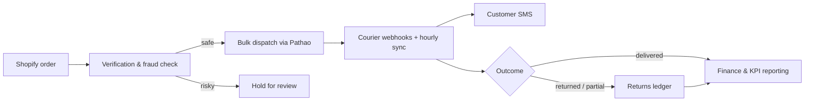

## Highlights

| | |
|---|---|
| ⚡ **Bulk dispatch** | Select many orders, validate, and create Pathao consignments in one action, with duplicate-consignment protection |
| 🛡️ **Fraud intelligence** | Customer and phone history checked through FraudSpy / Mr. Fraud Checker; risky orders are tagged and held before COD dispatch |
| 🔄 **Two-way courier sync** | Signed Pathao webhooks plus an hourly QStash reconciliation job keep order state accurate, including partial deliveries and paid returns |
| 💬 **Automated SMS** | Dispatch and delivery notifications with editable Bangla/English templates through the MIM SMS gateway |
| 📊 **Live KPIs and reports** | Daily and monthly reporting, cached dashboard metrics, CSV and PDF export |
| 💰 **Finance ledger** | Income and expense transactions with COD collection and reconciliation views |
| 📱 **Warehouse-ready UI** | Responsive, touch-friendly interface for desktop managers and mobile warehouse staff |
| 🧩 **Shopify embedded view** | Order detail pages that render inside the Shopify admin |

> **Impact (internal estimate):** the system automates 15+ operational pain points and cut targeted manual workload by roughly 45%. The batch pipeline is designed for bursts of 1,000+ orders; real throughput is bounded by courier API limits.

## Screenshots

### Desktop

| Dashboard & analytics | Orders & dispatching | Dispatches & returns |
|:--:|:--:|:--:|
| 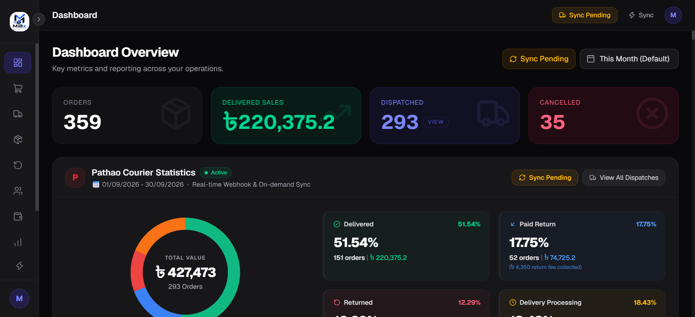 | 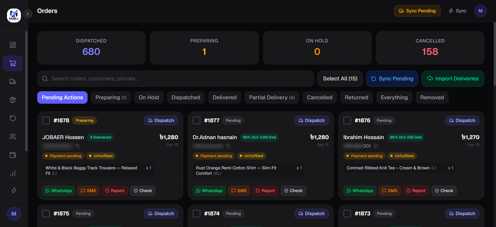 | 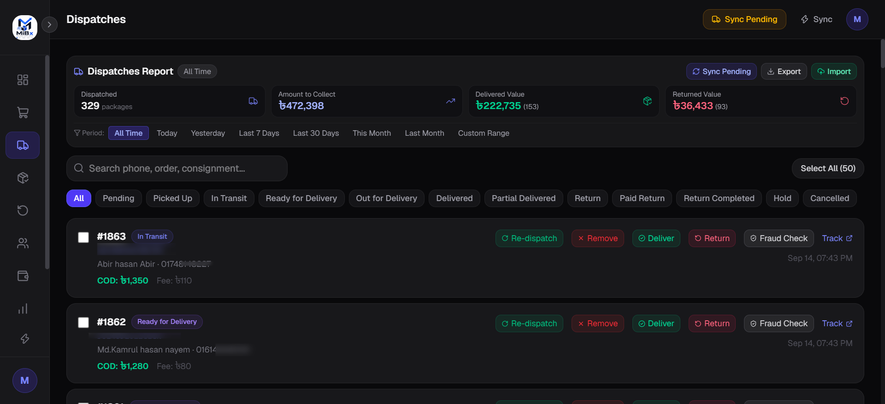 |
| **Finance & reconciliation** | **Reporting** | **Settings & integrations** |
| 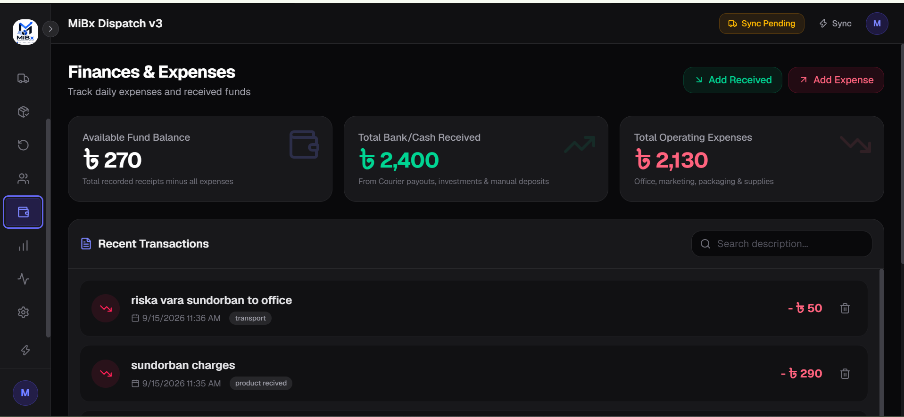 | 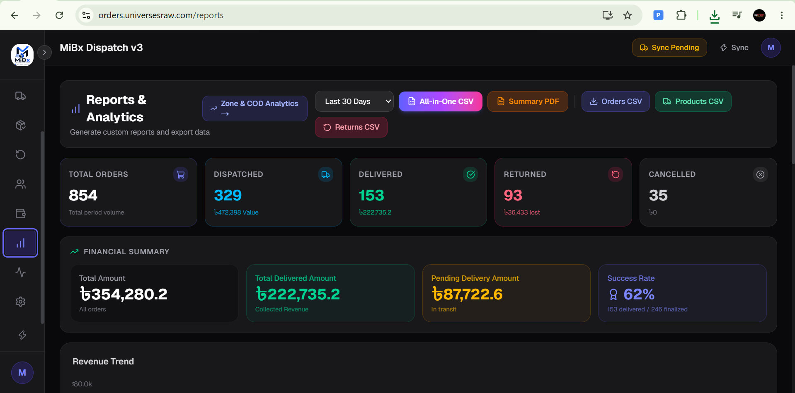 | 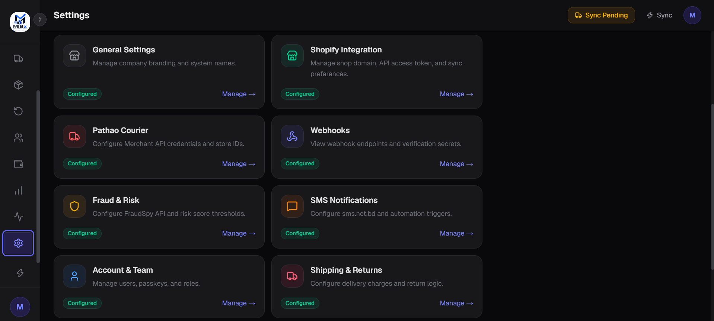 |

### Mobile / warehouse

| Dashboard | Orders | Reports | Settings |
|:--:|:--:|:--:|:--:|
| 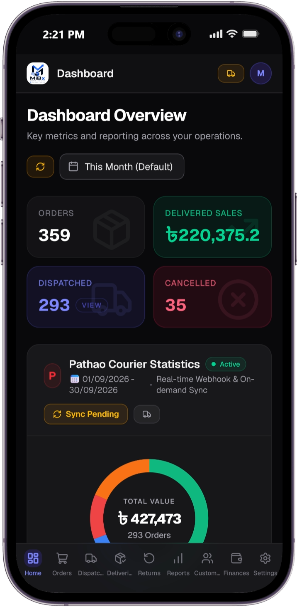 | 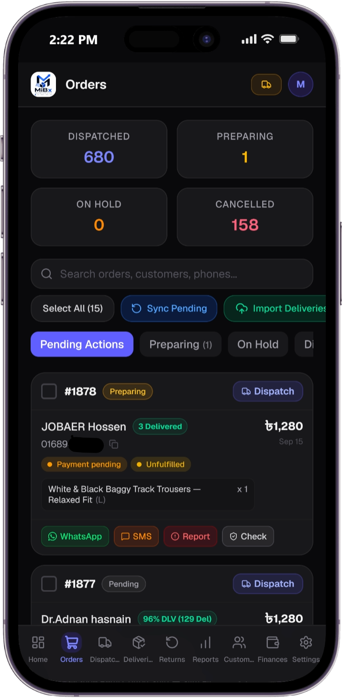 | 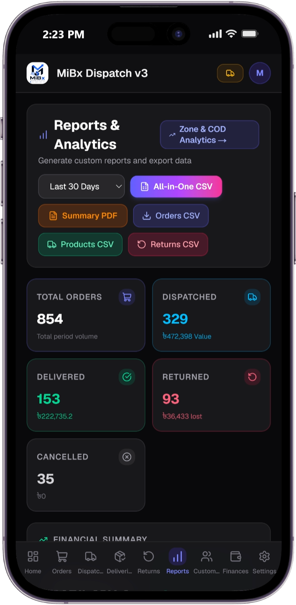 | 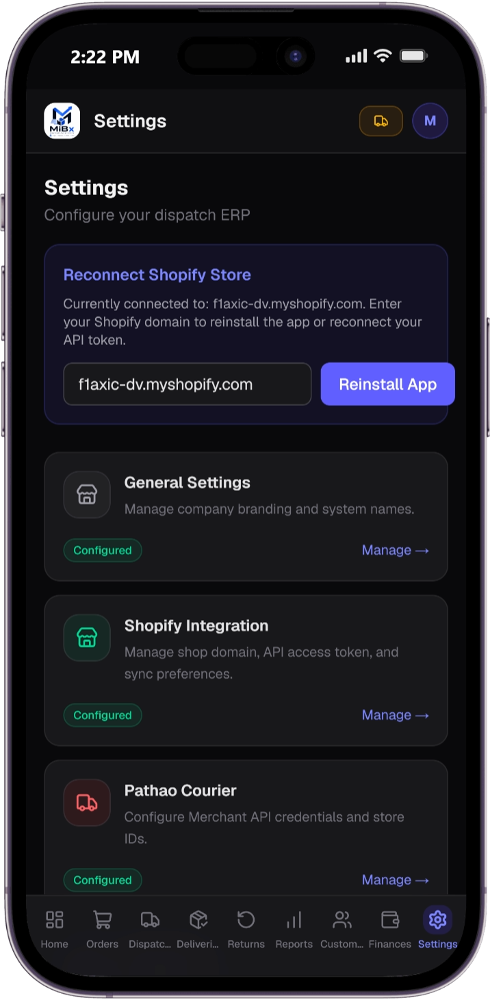 |

## How it works

### 1. Order ingestion
Shopify webhooks (`orders/create`, `orders/updated`, `orders/cancelled`, `orders/paid`, `refunds/create`, `returns/*`) hit `/api/webhooks/shopify`. Each request is verified with **HMAC-SHA256** before the order and customer are upserted into PostgreSQL. If fraud checking is enabled, the customer is scored and the Shopify order is tagged automatically.

### 2. Dispatch
Staff pick eligible orders and confirm the Pathao store and delivery mode. For each order the platform:

1. Checks for an existing active consignment (returns `409 Conflict` unless explicitly forced)
2. Creates the Pathao consignment and delivery fee
3. Writes the `dispatches` record and moves the order to `dispatched`
4. Creates the Shopify fulfillment with tracking number and URL
5. Tags the Shopify order and sends the customer an SMS with the tracking link and COD amount

### 3. Delivery and return reconciliation
Pathao posts status events (`Delivered`, `Partial Delivered`, `Returned`, `Paid Return`, `Cancelled`, `Out for Delivery`) to `/api/webhooks/pathao`. An **hourly QStash job** (`/api/cron/courier-sync`) reconciles in-flight parcels in case a webhook is missed.

| Courier event | System reaction |
|---|---|
| Delivered | `delivered_at` set, Shopify fulfillment marked delivered, SMS sent |
| Partial delivery | `returns` record created, line items and totals adjusted |
| Returned / Paid return | `returned_at` set, return fee tracked, order moved to returned |

Every transition purges the relevant Redis dashboard cache keys so KPIs stay fresh.

## Architecture

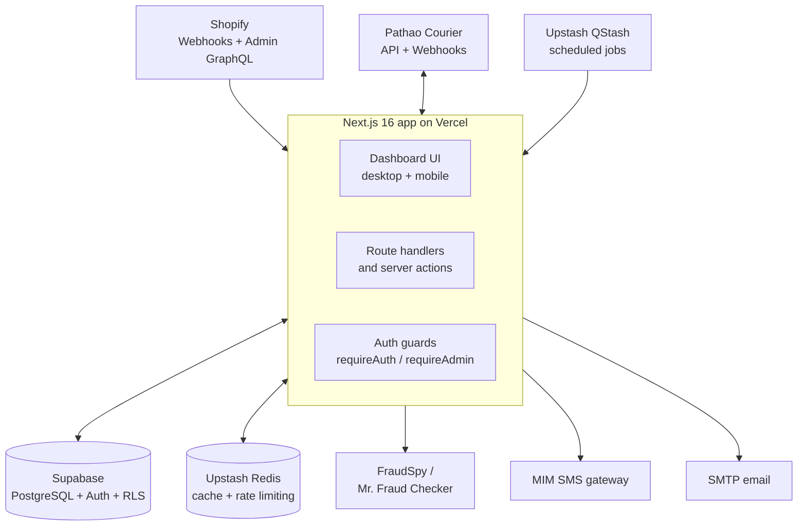

**Design principles**

- **Server-side integrations.** Courier, fraud, SMS and Shopify credentials never reach the browser.
- **Event-driven.** Webhooks drive state changes; scheduled reconciliation is the safety net.
- **Postgres as the source of truth** for orders, dispatches, returns, events and finance.
- **Fail closed.** Webhook and cron endpoints reject requests when their secret is missing or invalid.

### Data model

| Table | Purpose |
|---|---|
| `profiles` | Users mapped to Supabase Auth, with `admin` / `staff` roles |
| `app_settings` | Global configuration, store settings, delivery defaults, SMS templates |
| `customers` | Denormalized Shopify customers with order totals and preferences |
| `orders` | Central order table with Shopify metadata, line items, financial and internal status |
| `dispatches` | Pathao consignments, fees, status timeline, dispatcher attribution |
| `returns` | Returns, partial rejections, restocking status, return charges |
| `order_events` | Audit trail of every lifecycle event |
| `webhook_logs` / `sync_logs` | Telemetry for inbound webhooks and background syncs |
| `shopify_orders`, `shopify_products`, `shopify_collections`, `shopify_line_items` | Reporting tables for sales analytics |
| `transactions` | Income and expense ledger |

## Security

Security was treated as a feature and then verified with a full hardening audit.

- **Authentication and RBAC.** Supabase Auth sessions (`httpOnly`, `secure`, `sameSite`) refreshed in middleware. Privileged server actions pass through a central guard (`requireAuth()` / `requireAdmin()`); team invitations, settings and financial deletions are admin-only.
- **Webhook integrity.** Shopify HMAC-SHA256 verification; Pathao secret verification with `crypto.timingSafeEqual`; QStash signature verification on cron endpoints.
- **Fail-closed endpoints.** No hardcoded fallbacks; missing secrets mean `401`.
- **Abuse protection.** Upstash Redis rate limiting on login; open-redirect protection on `redirectTo`; PostgREST filter sanitization for search input.
- **Browser hardening.** HSTS (preload), `X-Content-Type-Options`, `Referrer-Policy`, `Permissions-Policy`, COOP, and a CSP `frame-ancestors` policy tailored to the Shopify embedded admin.
- **Secrets hygiene.** `.env*` is git-ignored (only `.env.example` is tracked), production credentials are scoped to the Production environment on Vercel, and `npm audit` reports zero known vulnerabilities.

Found a vulnerability? Please follow the [security policy](./SECURITY.md).

## Engineering quality

- **TypeScript** end to end; `tsc --noEmit` passes with zero errors
- **Vitest** suite covering dispatch flows, duplicate-consignment protection, status transitions and dates, SMS templating, redirect sanitization, search sanitization and timing-safe secret checks
- **GitHub Actions CI**: type-check, tests, production build and high-severity dependency audit on every push
- **Performance work**: PDF libraries loaded on demand (about 400 KB removed from the initial Reports bundle), composite indexes on `orders`, `dispatches` and `webhook_logs`, Redis-cached dashboard metrics, explicit function timeouts for long sync jobs
- **51 routes** building cleanly with Turbopack

## Tech stack

| Layer | Technology |
|---|---|
| Framework | Next.js 16 (App Router, Turbopack), React 19 |
| Language | TypeScript 5 |
| UI | Tailwind CSS 4, shadcn/ui, Radix UI, Lucide, Sonner, Recharts |
| Database & auth | Supabase (PostgreSQL, Auth, Row Level Security) |
| Cache & queues | Upstash Redis, Upstash QStash |
| Integrations | Shopify Admin GraphQL, Pathao Hermes API, FraudSpy, Mr. Fraud Checker, MIM SMS, SMTP |
| Reporting | jsPDF + AutoTable, CSV export |
| Testing & CI | Vitest, ESLint, GitHub Actions |
| Hosting | Vercel + Supabase + Upstash |

## Getting started

### Prerequisites

- Node.js 20.9+ (required by Next.js 16)
- A Supabase project
- Upstash Redis and QStash
- A Shopify custom app with Admin API access
- Pathao merchant API credentials
- Optional: FraudSpy / Mr. Fraud Checker keys, MIM SMS account, SMTP account

### Setup

```bash
git clone https://github.com/MiBx-69/MIBx-Dispatch.git
cd MIBx-Dispatch
npm install
cp .env.example .env.local
```

Fill in `.env.local` (see below), then prepare the database:

```bash
supabase link --project-ref <your-project-ref>
supabase db push
```

Run it:

```bash
npm run dev      # http://localhost:3000
```

### Environment variables

Never commit real values. `.env*` is git-ignored except `.env.example`.

| Group | Variables |
|---|---|
| Supabase | `NEXT_PUBLIC_SUPABASE_URL`, `NEXT_PUBLIC_SUPABASE_ANON_KEY`, `SUPABASE_SERVICE_ROLE_KEY` |
| Upstash Redis | `UPSTASH_REDIS_REST_URL`, `UPSTASH_REDIS_REST_TOKEN` |
| QStash / cron | `QSTASH_CURRENT_SIGNING_KEY`, `QSTASH_NEXT_SIGNING_KEY`, `CRON_SECRET` |
| Shopify | `SHOPIFY_SHOP_DOMAIN`, `SHOPIFY_ACCESS_TOKEN`, `SHOPIFY_WEBHOOK_SECRET`, `SHOPIFY_API_VERSION` |
| Pathao | `PATHAO_BASE_URL`, `PATHAO_CLIENT_ID`, `PATHAO_CLIENT_SECRET`, `PATHAO_USERNAME`, `PATHAO_PASSWORD`, `PATHAO_WEBHOOK_SECRET` |
| Email | `SMTP_HOST`, `SMTP_PORT`, `SMTP_USER`, `SMTP_PASS` |
| App | `NEXT_PUBLIC_APP_URL`, `APP_SECRET`, `NEXT_PUBLIC_APP_NAME` |
| Fraud (optional) | `FRAUDSPY_API_KEY`, `MR_FRAUD_CHECKER_API_KEY` |

Generate strong secrets with `openssl rand -hex 32`.

### Scripts

```bash
npm run dev      # development server
npm run build    # production build
npm run start    # run the production build
npm run lint     # ESLint
npx vitest       # unit / integration tests
```

## Deployment

Designed for **Vercel + Supabase + Upstash**.

1. Import the repo into Vercel and add the environment variables to the **Production** environment only
2. Apply the database migrations to your Supabase project
3. Point Shopify webhooks to `/api/webhooks/shopify` and Pathao webhooks to `/api/webhooks/pathao`
4. Create a QStash schedule for `/api/cron/courier-sync` (hourly) and `/api/cron/sales-sync`
5. Deploy; `vercel.json` sets longer function timeouts for sync jobs

## Project structure

```text
.
├── .github/workflows/   # CI: type-check, tests, build, dependency audit
├── public/demo-data/    # Screenshots used in this README
├── scripts/             # Operational scripts
├── src/
│   ├── app/
│   │   ├── (dashboard)/ # Orders, dispatches, finance, reports, settings
│   │   ├── embedded/    # Views rendered inside the Shopify admin
│   │   └── api/         # dispatch, orders, customers, auth, webhooks, cron
│   ├── lib/             # Shared logic, incl. auth-guard (RBAC)
│   ├── proxy.ts         # Session refresh and route protection
│   └── types/           # Database types
├── supabase/            # Migrations
├── schema.sql           # Database schema
├── ARCHITECTURE.md      # Deeper data-flow documentation
└── SECURITY.md          # Vulnerability reporting
```

## Why this project matters

MiBx Dispatch is the result of one repeatable approach: **find the repetitive work, model the real process, connect the systems, automate the bottleneck, expose the right KPIs, and secure the workflow.** It is not a demo dashboard. It runs a real store's daily operations, and it has been through a structured audit, a test suite and a CI pipeline.

## Author

**Moinul Islam Bappi**: Head of IT & Online Executive and full-stack developer focused on e-commerce automation, Shopify systems, logistics integrations and secure web architecture.

- 🌐 Portfolio: [moinulislam.pro](https://moinulislam.pro)
- 💼 LinkedIn: [linkedin.com/in/moinul-islam-bappi](https://linkedin.com/in/moinul-islam-bappi)
- 🐙 GitHub: [@MiBx-69](https://github.com/MiBx-69)

<div align="center">

**Built to turn manual e-commerce operations into software.**

</div>
